# EdiKOla

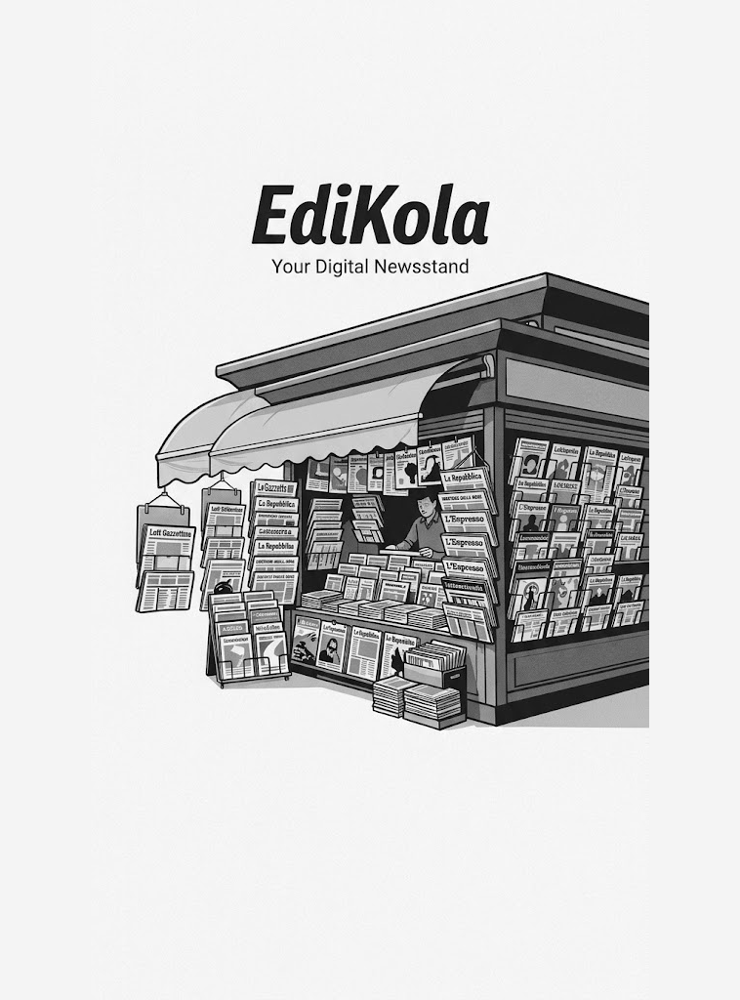

A newsstand ("edicola") for an old Kobo, made for an elderly reader: free newspapers without ads,
your own books, big buttons, and almost no gestures. It is a [KOReader](https://github.com/koreader/koreader)
plugin, and the Kobo boots straight into it.

Built for a **Kobo Nia** (N306, 758×1024, 212 dpi). It should work on any Kobo that runs KOReader.

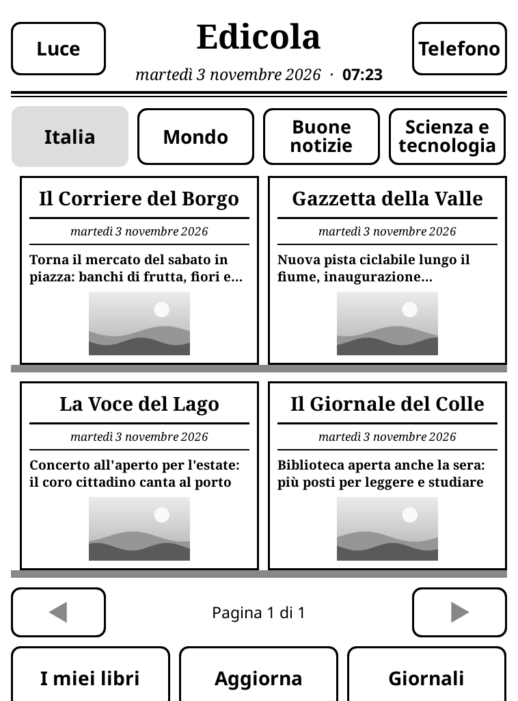
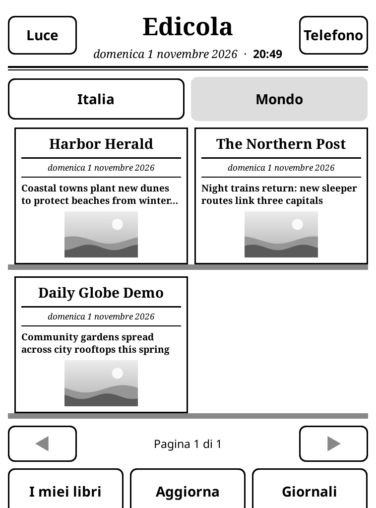
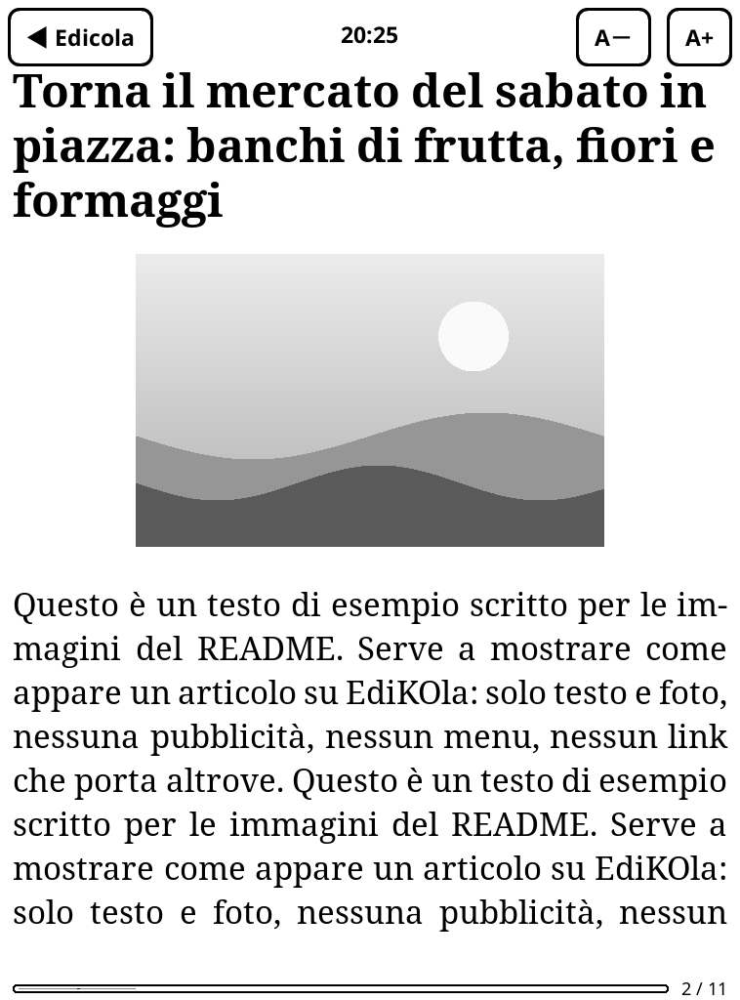

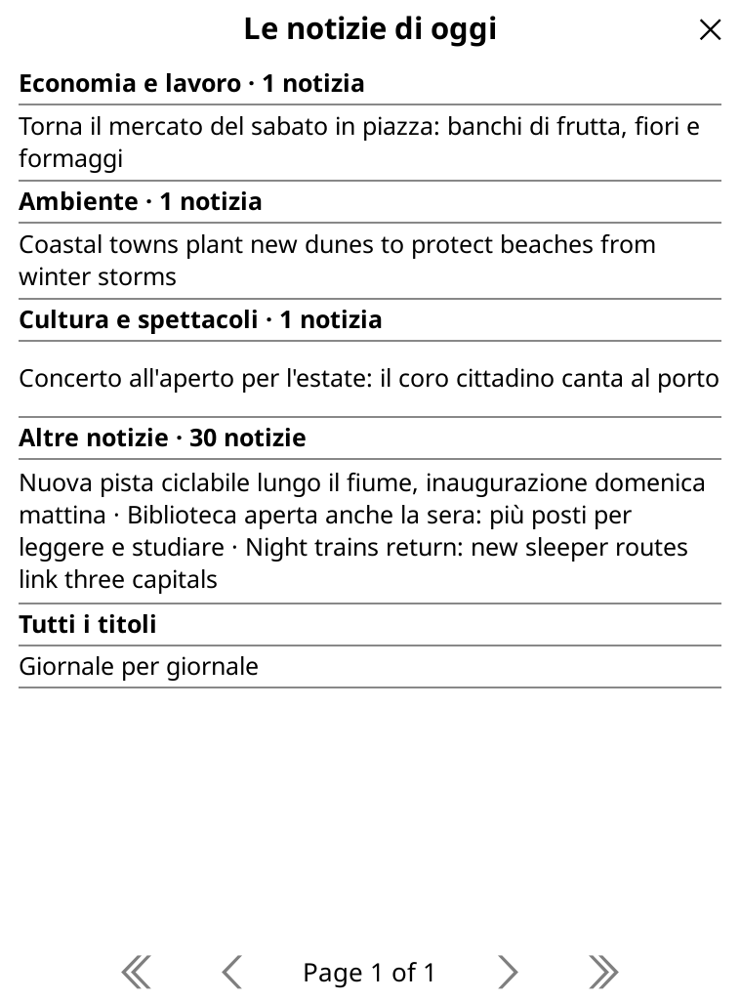
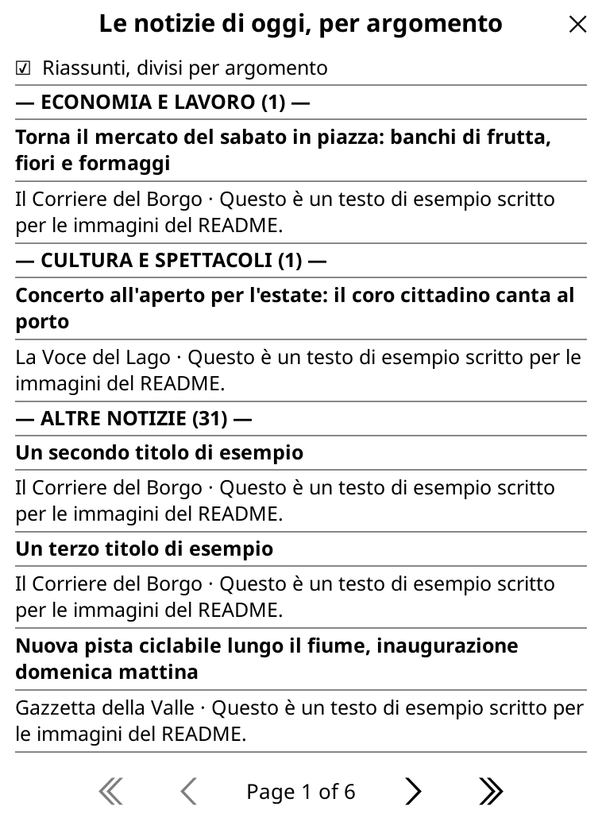
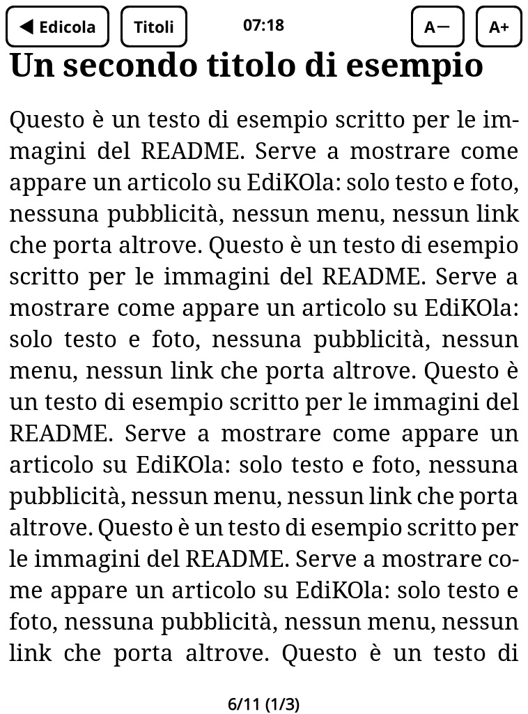

### On a Bigme B6 Pro Color (`bigme` branch)

The same newsstand on a color e-ink Android reader: shelves and Sommario topics in color, color photos,
and **Appunti**, pen notes on every article plus a notebook. Install: [docs/BIGME.md](docs/BIGME.md).

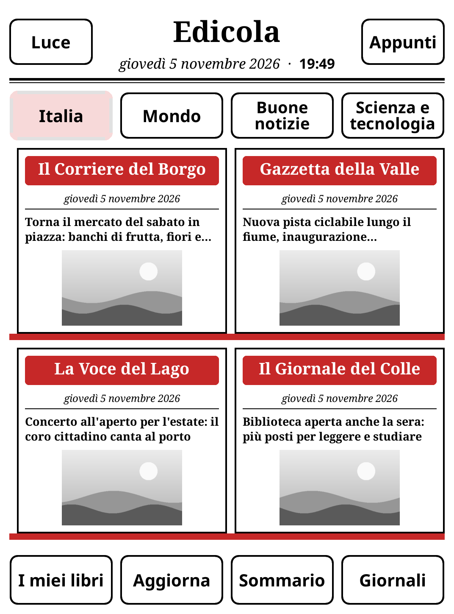
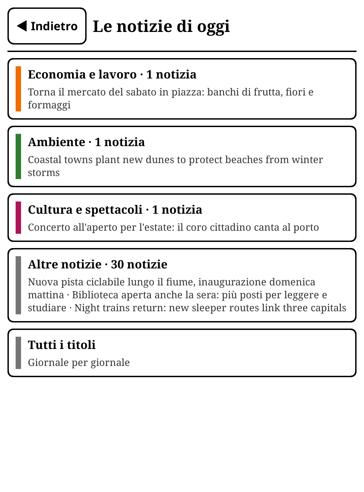
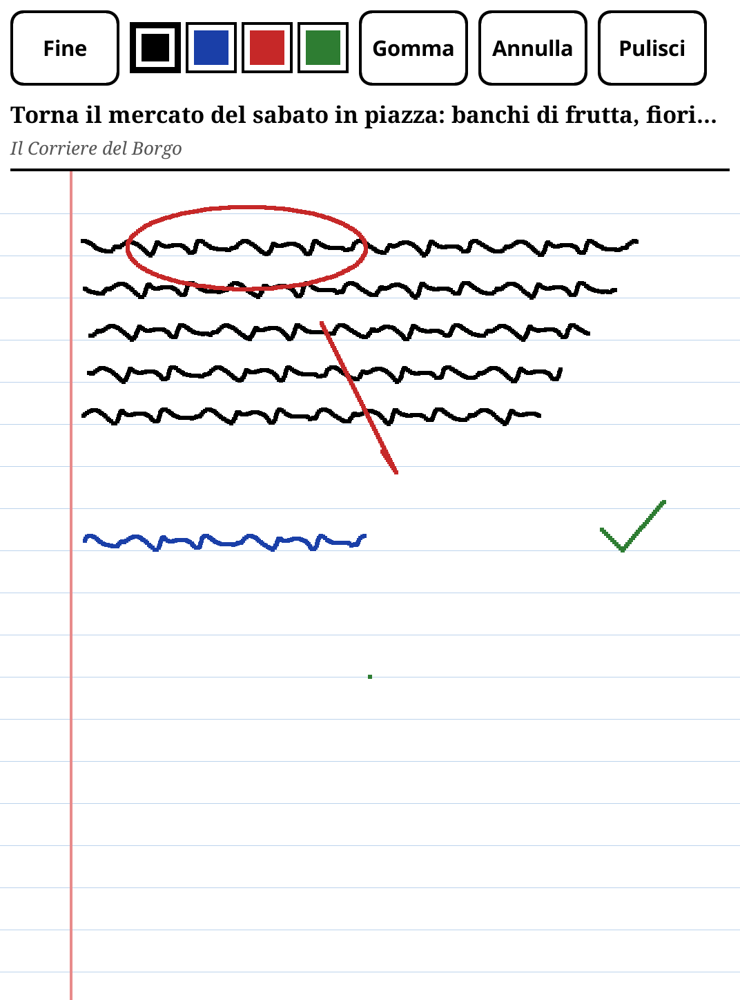
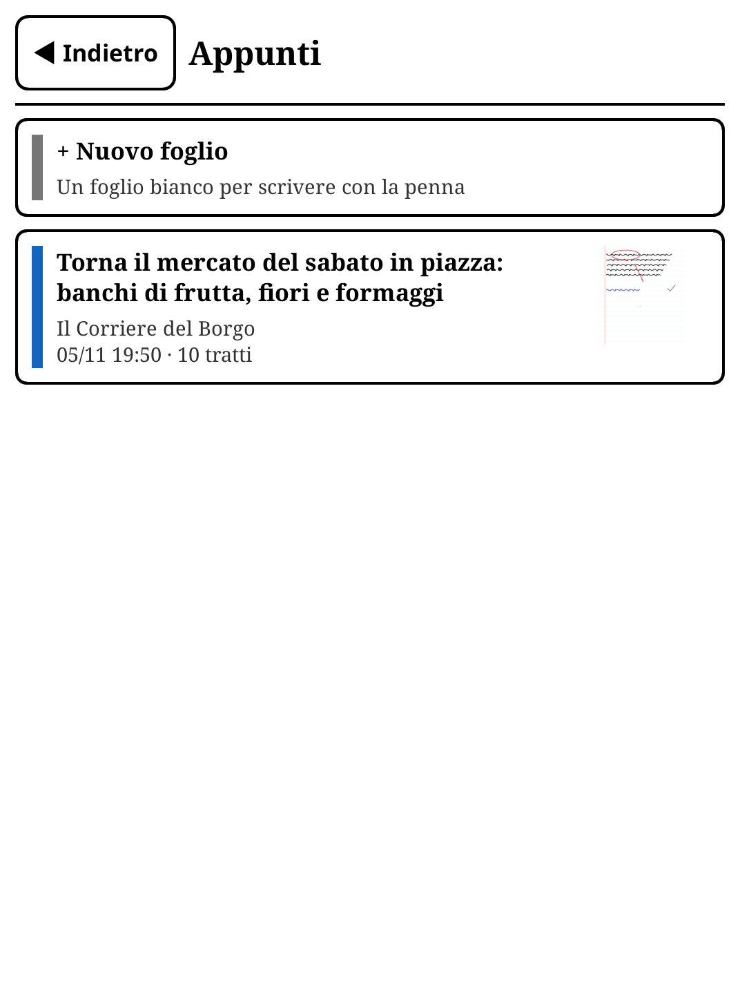

*Screenshots come from KOReader's emulator at the Nia's resolution (Bigme ones at 1072×1448, 300 dpi). The newspapers and articles in them
are fictional demo content (`tools/screenshots/make_demo.py`).*

## What it does

- **Edicola**: the home screen. Four shelves: **Italia** and **Mondo** (news, politics, economy), **Buone notizie** (good news only) and **Scienza e tecnologia**. Each shows a front page per
  newspaper: masthead, date, top headline and photo. Tap a newspaper to read today's edition. It is
  downloaded first if needed: Wi-Fi turns on by itself, then turns off again.
- **Clean articles**: each edition is one EPUB. A front page lists the headlines, then there's one
  chapter per article with just the text and up to 3 photos. Menus, ads, sidebars, cookie walls and
  outbound links are removed by a small text-density extractor (`knp_extract.lua`). The last 3 days
  are kept.
- **Quick updates**: **Aggiorna** downloads 4 newspapers at a time, and only articles it doesn't have yet.
  Downloaded articles and photos are kept per newspaper, so a paper with no new articles costs just its feed.
- **Sommario**: after **Aggiorna** (or from its button), the day's news in Italian, a little of everything first:
  one entry per topic (politics, economy, world, crime, health, science, environment, culture, sport) with how
  many articles and its main headlines. Tap a topic for each of its articles with its opening sentences; tap an
  article to read it. **Tutti i titoli** lists every title by newspaper. Topics come from keywords
  (`knp_topics.lua`); no language model, which would be far too slow on the Kobo. English papers (`lang = "en"`
  in the catalog) get their titles and briefs translated during **Aggiorna** with KOReader's own translator
  (Google Translate), once per article; the articles themselves stay in English.
- **Giornali**: tick which of the 45 free newspapers in the catalog (`giornali.lua`) go on the shelves.
- **Wi-Fi that retries**: if the router refuses the Kobo an address, it asks again, up to 3 rounds, instead of giving up after 30 s.
- **I miei libri**: every EPUB/PDF on the device in one big list. One tap opens a book.
- **Luce**: frontlight brightness and warmth.
- **Telefono**: receive files from a phone over Wi-Fi with the free [LocalSend](https://localsend.org)
  app (Android/iOS). The phone shares a file to *LocalSend → EdiKOla*, and the file appears in
  *I miei libri*.
- **Reading**: tap the right or left side of the page to turn it. A big **◀ Edicola** button in the
  top-left corner goes back; next to it, **Titoli** goes back to the newspaper's front page and its headlines. Long-press a word to look it up in Italian, English, Italian→English and
  English→Italian.
- **Text size and photos**: **A− / A+** in the top-right corner make the text smaller or bigger. Pinch and
  spread work too, and zoom PDFs. Tap a photo to see it full screen, where you can also zoom it.
- **Clock** at the top of the screen, next to the date on the Edicola and while reading. At the bottom of an article,
  **18/40 (1/5)**: page 18 of 40 in the paper, page 1 of 5 of this article.
- **Lock screen**: the EdiKOla newsstand drawing (`konewspaper.koplugin/lockscreen/`).
- **Tuned for e-ink**: text size 26, a full refresh every 6 pages and on pages with photos, photos
  downloaded at about 800 px.

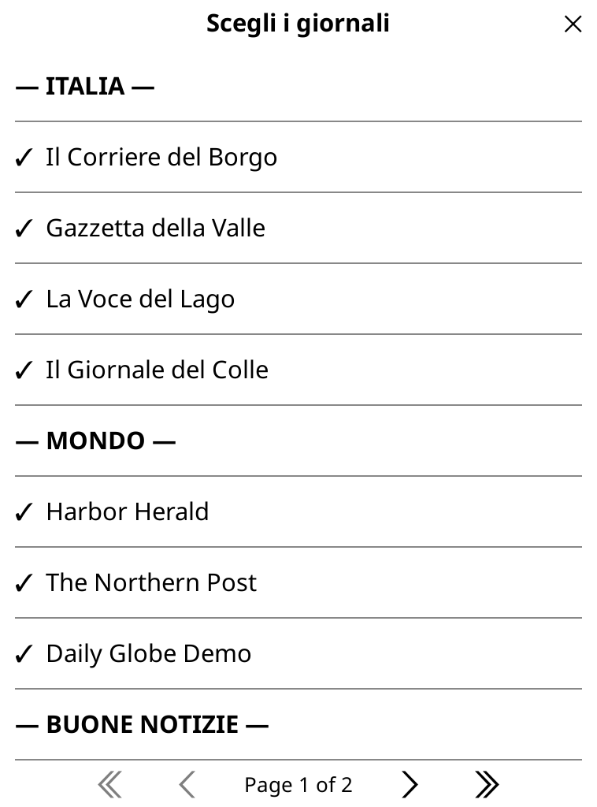
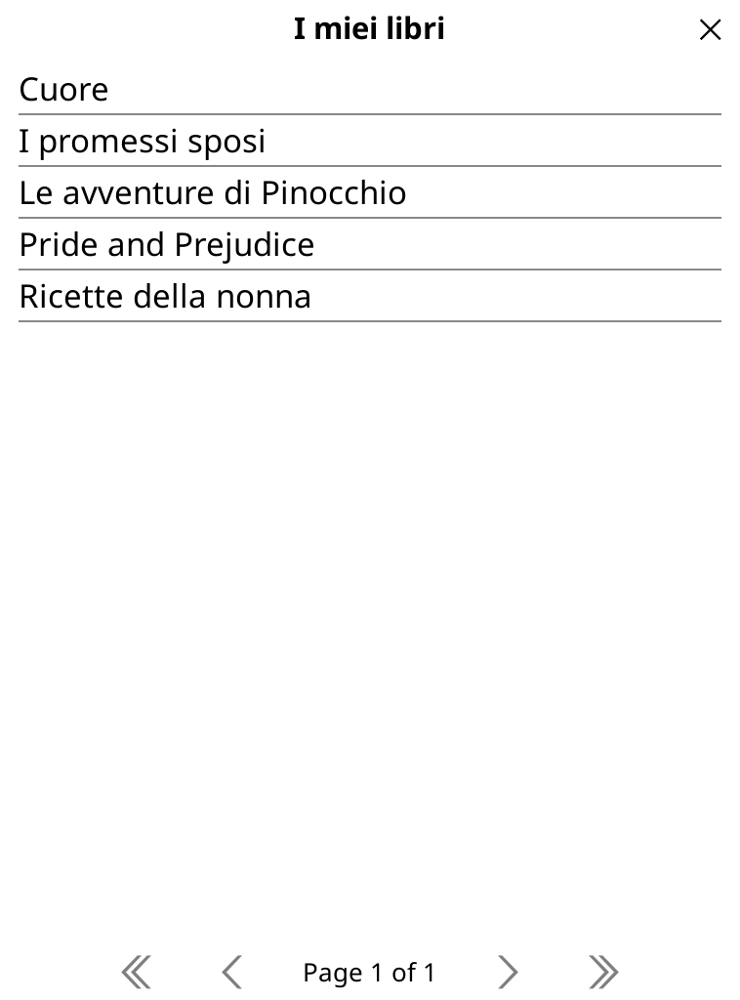
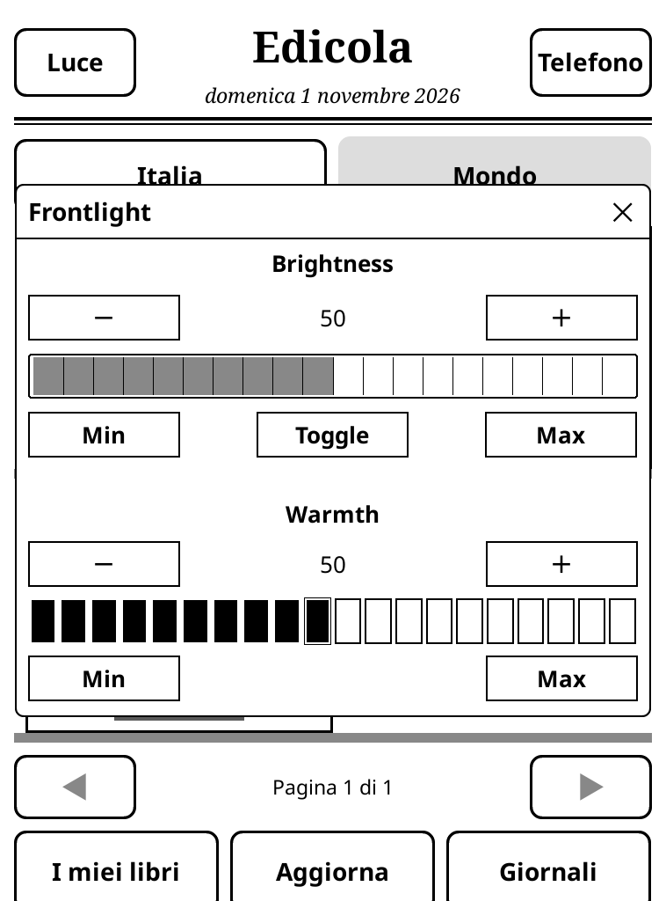
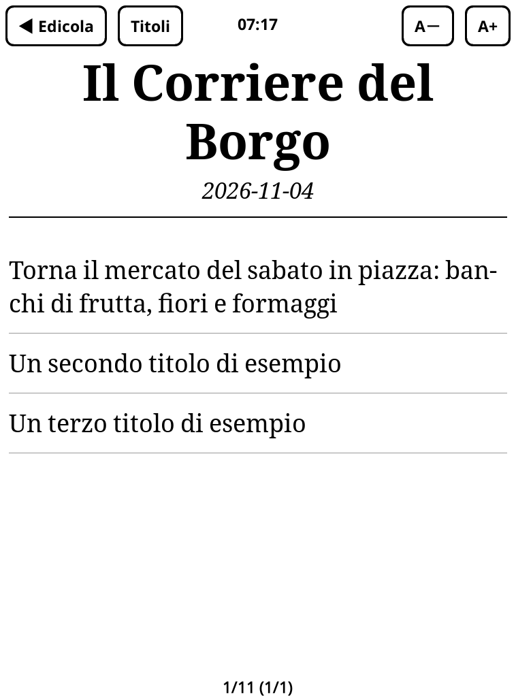

## Layout

| Path | What |
|---|---|
| `konewspaper.koplugin/` | The KOReader plugin: `main.lua` (UI), `knp_build.lua` (download → EPUB), `knp_extract.lua` (RSS + article extraction, pure Lua), `giornali.lua` (catalog), `knp_cards.lua` (card lists), `knp_theme.lua` (colors, gray on grayscale screens), `knp_notes.lua` + `knp_ink.lua` (pen notes) |
| `bigme/` | Bigme B6 Pro Color: `build.sh` (KOReader APK + plugin + `patches/2-edikola-bigme.lua`, which turns color on) |
| `autoboot/` | `KoboRoot.tgz` that starts KOReader right after Nickel boots. Nickel stays installed as the fallback |
| `tests/` | `texlua tests/notes-test.lua` (pen notes), `texlua tests/konewspaper-test.lua` (fixtures), `… live` (checks every newspaper in the catalog). `build-cache-test.lua` runs on KOReader's Linux build: `cd $KO/lib/koreader && ./luajit <repo>/tests/build-cache-test.lua` |
| `tools/screenshots/` | Regenerates `docs/images` with KOReader's Linux build: `KO=~/kosim sh tools/screenshots/run.sh` (`BIGME=1` for `docs/images/bigme`) |
| `CHANGES.md` | Every change made to the device, with how to undo it |

## Install

First time? [docs/TUTORIAL.md](docs/TUTORIAL.md) goes from a new Kobo to EdiKOla step by step, with a check after each step. In short:

1. Install KOReader on the Kobo (the [one-click package](https://www.mobileread.com/forums/showthread.php?t=314220)).
2. Copy `konewspaper.koplugin/` to `.adds/koreader/plugins/`.
3. Install [localsend.koplugin](https://github.com/kaikozlov/localsend.koplugin) (armv7 build) in the
   same folder, for the **Telefono** button.
4. Dictionaries go in `.adds/koreader/data/dict/`. The ones used here are reader.dict IT, the
   en-en and it-en Wiktionary builds, and FreeDict eng-ita (see `CHANGES.md`, change set 4).
5. To boot straight into KOReader, copy `autoboot/KoboRoot.tgz` to `.kobo/` and eject the Kobo.
   To skip it for one boot, create `.adds/noautoboot`. A factory reset undoes everything.

## Credits

KOReader (AGPL-3.0) · localsend.koplugin by kaikozlov (MIT) · LocalSend · reader.dict, Wiktionary
(CC-BY-SA), FreeDict dictionaries. News comes from each publisher's public RSS feed and is downloaded
for personal reading only.
