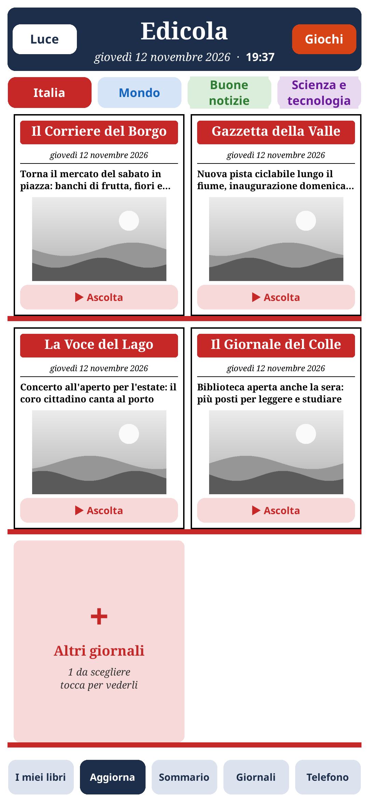
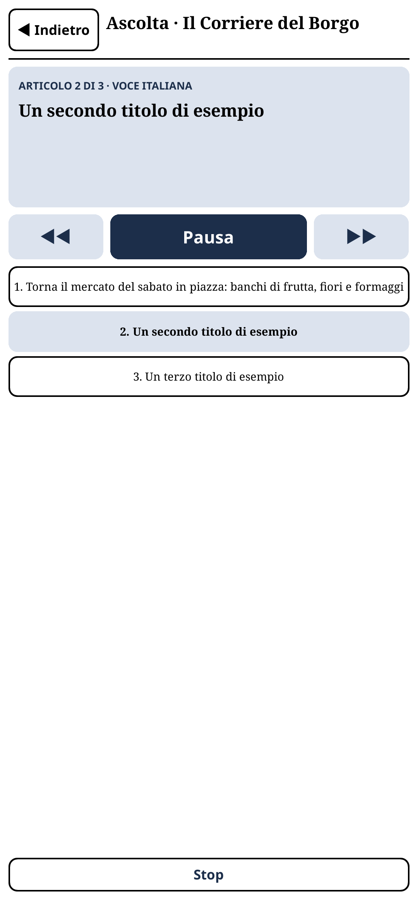
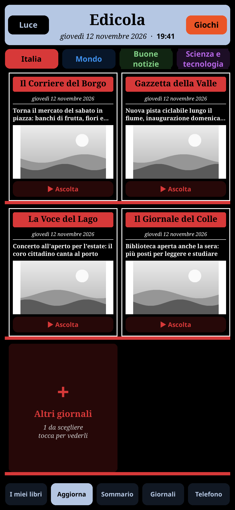
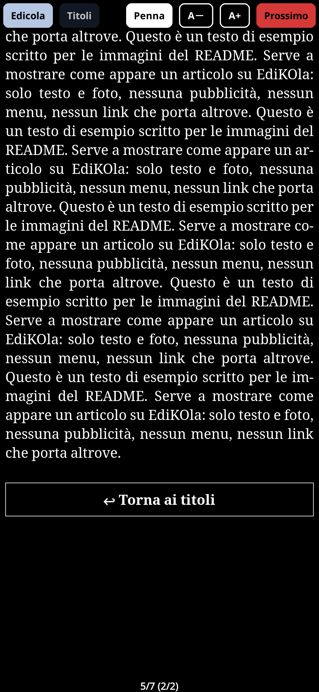

# EdiKOla on an Android phone

The `Android` branch: the same EdiKOla as on the Bigme (`bigme-main`), packed as one APK for a phone.
`EdiKOla.apk` is the official KOReader for Android (v2026.07.1, arm64) with EdiKOla already inside: install it
and the Edicola is there, nothing to copy.

What's different on a phone:
- **Ascolta**: every front page has a **▶ Ascolta** button that reads the edition aloud, like an audiobook,
  all on the phone (no internet, no account). The paper's name and date, then each article, title first.
  Italian articles are read by an Italian voice (Paola), English ones by a British voice (Alba): the language
  is told from each article's text.
- **Notte** (top left, where e-readers have **Luce**): KOReader's night mode, light text on black. EdiKOla's
  colors keep their hue in it (a red shelf stays red, light tints turn dark).
- **Taller shelves**: on a phone's tall screen the Edicola shows 3 rows of front pages instead of 2.

<p>




</p>

## Build (on the computer)

```sh
sh android/build.sh out-android
```

Needs `curl`, `7z`, `zip` and Java. Downloads, all pinned by SHA-256: KOReader, uber-apk-signer, sherpa-onnx
v1.13.6 for Android (the speech engine: its C library goes next to KOReader's own libraries in the APK) and
the two Piper voices (int8, about 18 MB each, into the plugin's `voci/` folder, with espeak-ng's Italian and
English dictionaries). The APK is about 66 MB.

The first run makes a signing key in `~/.config/edikola/android.jks` (other path: `KEYSTORE=...`): **keep it**,
Android only installs an update over the app if it is signed with the same key.

**Check**: `out-android/EdiKOla.apk` is there.

## Install (on the phone)

1. The app is KOReader with another signature, under KOReader's own id (`org.koreader.launcher`): if the
   official KOReader is installed, uninstall it first (its `koreader` folder stays, with settings and books).
2. Copy `EdiKOla.apk` to the phone (USB, LocalSend, ...) and open it; allow installing from that app.
3. Open **KOReader** and allow access to all files (EdiKOla keeps `KoNewspaper`, `Libri`, `Appunti` on the
   internal storage).

**Check**: the Edicola opens; **Aggiorna** downloads the papers.

## Ascolta

- **▶ Ascolta** on a front page (once its edition is downloaded) opens the player and starts reading.
  The first words come after a moment: the voice makes the audio a few sentences ahead.
- The player: the article being read, **Pausa**/**Riprendi**, **◀◀ ▶▶** previous and next article, the list
  of articles (tap one to jump there), **Stop**. **Indietro** goes back to the Edicola and keeps reading;
  the front page says **In ascolto**, tap it to come back to the player.
- **With the screen off it keeps reading**, as long as EdiKOla is the last app you had open. If you switch to
  another app, Android freezes EdiKOla after a few seconds and the reading stops within a few sentences
  (going on would take a foreground service, which a KOReader plugin can't add).
- The audio is made in `koreader/cache/edikola-voce` and deleted as it is played, and when reading stops.

**Check**: Ascolta on a paper with an English article: the voice changes. Turn the screen off: it keeps
reading into the next article.

How it works (`knp_voce.lua`, `knp_ascolta.lua`): a child process calls sherpa-onnx's C API through LuaJIT's
FFI and writes one WAV per few sentences; EdiKOla plays them with Android's MediaPlayer through JNI, each
chained to the next (`setNextMediaPlayer`) so there are no gaps. While audio plays Android keeps the phone
awake, so EdiKOla's timer still runs with the screen off and chains the next piece. If Android stops the child
process, the player starts it again.

Voices: Paola (`it_IT-paola-medium`, dataset licence on its page:
https://huggingface.co/datasets/paolapersico1/Voice-Dataset-Italian) and Alba (`en_GB-alba-medium`, CC BY 4.0),
from the Piper project, as converted by sherpa-onnx. Their model cards are in `voci/it` and `voci/en`.

## Differences from the Bigme

- No `2-edikola-bigme.lua` patch: a phone screen is color for KOReader already.
- The pen part (`knp_android.lua`) works with any Android stylus (e.g. S Pen); E-Ink Center's handwriting
  mode is Bigme only and is skipped (a line in `crash.log`, nothing else).
- KOReader's own update check offers official builds: they don't install over this one (other signature).
  Update by rebuilding and installing the new `EdiKOla.apk`.

## Tests and screenshots (computer)

- `tests/voce-test.lua`, on KOReader's Linux build: reading an edition, language, pieces, and the player
  (on a silent player and a 20 times faster clock: pause, jump, the child process killed, the end).
  `VOCI=` a `voci/` folder (`~/.cache/edikola-build/voci` after a build) with a `lib/` holding
  `libsherpa-onnx-c-api.so` and `libonnxruntime.so` from `sherpa-onnx-v1.13.6-linux-x64-shared.tar.bz2`:
  `cd $KO/lib/koreader && VOCI=... ./luajit <repo>/tests/voce-test.lua`
- Screenshots at a phone's 1080x2340, 450 dpi, with Ascolta and night mode, into `docs/images/android`:
  `PHONE=1 VOCI=... KO=~/ko2607 sh tools/screenshots/run.sh`
